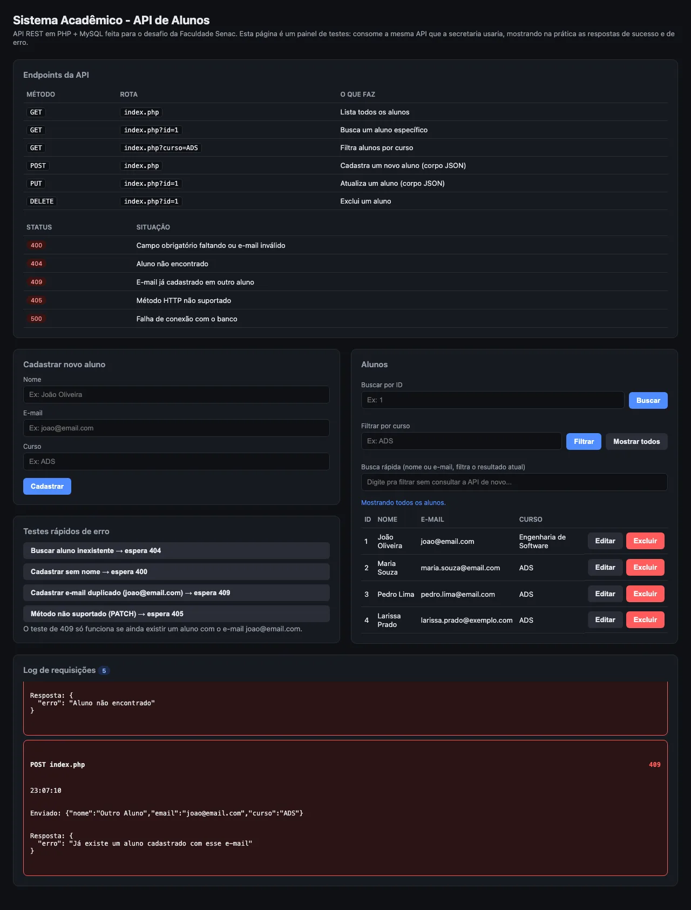
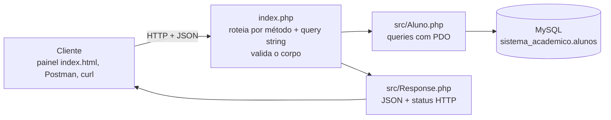
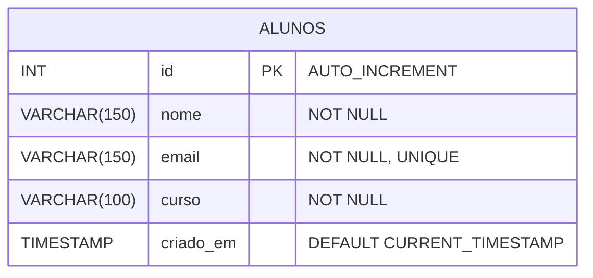

# Sistema Acadêmico - API REST (PHP + MySQL)

API REST em PHP puro (sem framework) para consultar, cadastrar, alterar
e excluir alunos, feita para o desafio da Faculdade Senac. Usa PDO para
falar com o MySQL do XAMPP e responde tudo em JSON.

**Equipe:** Pedro Szpak, Ademir Junior e Christian Ferreira.
**Disciplina:** Padrões de Projeto, Frameworks e APIs, Senac São José dos Pinhais.

A apresentação está em [`docs/apresentacao/`](docs/apresentacao): os slides
(`.pptx`) e o roteiro com o conteúdo e as falas de cada parte.



## Como funciona





## Documentação da API (OpenAPI e Postman)

| Arquivo | Como usar |
|---|---|
| [`docs/openapi.yaml`](docs/openapi.yaml) | Especificação OpenAPI 3.0 escrita a partir do `index.php`: rotas, corpos, exemplos e todos os erros. Para ver: cole em [editor.swagger.io](https://editor.swagger.io) ou rode `npx @redocly/cli@1.34.3 preview-docs docs/openapi.yaml` |
| [`docs/postman/sistema-academico-api.postman_collection.json`](docs/postman/sistema-academico-api.postman_collection.json) | Coleção Postman v2.1 com as consultas, o CRUD e um request para cada erro (400, 404, 405, 409). Importe no Postman e ajuste a variável `baseUrl` (padrão `http://localhost:8000`) |
| [`tests/requests.http`](tests/requests.http) | Os mesmos casos para a extensão REST Client do VS Code, com os `curl` equivalentes |

Rodar sem XAMPP, com MySQL em Docker (o que foi usado para os testes e o print acima):

```bash
docker run -d --name mysql-academico -e MYSQL_ALLOW_EMPTY_PASSWORD=yes -p 3307:3306 mysql:8.4
docker exec -i mysql-academico mysql -uroot < database/schema.sql   # espere o MySQL subir antes
DB_PORT=3307 php -S localhost:8000
# painel: http://localhost:8000/index.html   API: http://localhost:8000/index.php
```

## Testes realizados (16/11/2026)

Rodados com `php -S` contra um MySQL 8.4 com o `database/schema.sql`:

| Requisição | Status | Resposta |
|---|---|---|
| `GET index.php` | 200 | Lista os 3 alunos de exemplo |
| `GET index.php?id=1` | 200 | João Oliveira |
| `GET index.php?id=9999` | 404 | `{"erro": "Aluno não encontrado"}` |
| `GET index.php?curso=ADS` | 200 | Só Maria e Pedro (desafio extra) |
| `POST` com nome, e-mail e curso | 201 | Aluno criado com id |
| `POST` sem nome | 400 | `{"erro": "O campo nome é obrigatório"}` |
| `POST` com e-mail inválido | 400 | `{"erro": "O campo email é inválido"}` |
| `POST` com e-mail repetido | 409 | `{"erro": "Já existe um aluno cadastrado com esse e-mail"}` |
| `POST` com JSON quebrado | 400 | `{"erro": "JSON inválido no corpo da requisição"}` |
| `PUT index.php?id=1` corrigindo o e-mail do João | 200 | Aluno com o e-mail novo |
| `PUT index.php?id=9999` | 404 | `{"erro": "Aluno não encontrado"}` |
| `DELETE index.php?id=4` | 200 | `{"mensagem": "Aluno excluído com sucesso"}` |
| `DELETE` do mesmo id de novo | 404 | `{"erro": "Aluno não encontrado"}` |
| `PATCH` | 405 | `{"erro": "Método não suportado"}` |

## Arquitetura

```
sistema-academico-api/
├── index.php              # ponto de entrada da API (roteamento + validação)
├── config/
│   └── database.php        # conexão PDO com o MySQL
├── src/
│   ├── Aluno.php            # todas as queries da tabela `alunos`
│   └── Response.php         # helpers pra responder em JSON com status HTTP certo
├── database/
│   └── schema.sql           # cria o banco, a tabela e alguns dados de exemplo
├── tests/
│   └── requests.http        # exemplos prontos de cada rota, incluindo os erros
└── docs/
    ├── openapi.yaml         # especificação OpenAPI 3.0
    ├── postman/             # coleção Postman v2.1
    ├── media/               # print do painel
    └── apresentacao/        # slides e roteiro
```

A ideia da divisão em camadas é simples de explicar pro grupo inteiro:

- **`config/database.php`** só sabe abrir a conexão com o banco.
- **`src/Aluno.php`** só sabe montar e rodar as queries SQL (é o "model").
- **`index.php`** só sabe receber a requisição HTTP, validar os dados e
  decidir qual método do `Aluno` chamar, devolvendo a resposta em JSON.

Isso separa "banco de dados" de "regra da API" de "formato da resposta",
o que ajuda bastante quando 4 pessoas vão mexer no mesmo projeto ao
mesmo tempo.

## Rotas

Todas as rotas passam por `index.php`, usando o método HTTP e a query
string (sem precisar configurar `.htaccess`/`mod_rewrite`):

| Método | Rota                          | O que faz                                  |
|--------|-------------------------------|---------------------------------------------|
| GET    | `/index.php`                  | Lista todos os alunos                       |
| GET    | `/index.php?id=1`             | Busca um aluno específico                   |
| GET    | `/index.php?curso=ADS`        | Lista só os alunos de um curso (desafio extra) |
| POST   | `/index.php`                  | Cadastra um novo aluno (corpo em JSON)       |
| PUT    | `/index.php?id=1`             | Atualiza um aluno (corpo em JSON)            |
| DELETE | `/index.php?id=1`             | Exclui um aluno                              |

### Exemplo de corpo para POST/PUT

```json
{
    "nome": "João Oliveira",
    "email": "joao@email.com",
    "curso": "Engenharia de Software"
}
```

## Tratamentos de erro implementados

O desafio pede pelo menos 2 — implementamos 5:

| Situação                                      | Status HTTP | Resposta                                          |
|------------------------------------------------|-------------|----------------------------------------------------|
| Campo obrigatório faltando (nome/email/curso)   | 400         | `{"erro": "O campo nome é obrigatório"}`            |
| E-mail em formato inválido                      | 400         | `{"erro": "O campo email é inválido"}`              |
| Aluno não encontrado (GET/PUT/DELETE por id)    | 404         | `{"erro": "Aluno não encontrado"}`                  |
| E-mail já cadastrado em outro aluno             | 409         | `{"erro": "Já existe um aluno cadastrado com esse e-mail"}` |
| Método HTTP não suportado                       | 405         | `{"erro": "Método não suportado"}`                  |
| Falha de conexão com o banco                    | 500         | `{"erro": "Falha ao conectar com o banco de dados..."}` |

## Desafio extra (filtrar por curso)

`GET /index.php?curso=ADS` é resolvido em `Aluno::all()`: se o parâmetro
`curso` vier preenchido, a query SQL ganha um `WHERE curso = :curso`;
caso contrário, lista todo mundo. Nenhuma rota nova foi necessária.

## Como rodar (Mac e Windows)

O projeto precisa ficar **dentro da pasta `htdocs` do XAMPP** — é o
Apache do XAMPP que serve o PHP; não funciona abrir `index.php` direto
no navegador nem deixar a pasta em outro lugar do disco.

Caminho padrão do `htdocs` em cada sistema:

| Sistema | Caminho                                                        |
|---------|-----------------------------------------------------------------|
| Windows | `C:\xampp\htdocs\sistema-academico-api`                         |
| Mac     | `/Applications/XAMPP/xamppfiles/htdocs/sistema-academico-api`   |

### Passo a passo

1. Copie (ou clone) a pasta `sistema-academico-api` inteira pra dentro
   do `htdocs`, no caminho da tabela acima.
2. Abra o **XAMPP Control Panel** (Windows) ou o **XAMPP Control
   Panel/manager-osx** (Mac) e clique em **Start** no **Apache** e no
   **MySQL**. Os dois precisam ficar com status verde/"Running".
3. Importe o banco pelo **phpMyAdmin** (`http://localhost/phpmyadmin`)
   → aba **Importar** → selecione `database/schema.sql` → Executar.
4. Confira `config/database.php`: o padrão é `host=localhost`,
   `porta=3306`, `user=root`, `senha=''` (padrão do XAMPP). Só mexam
   nisso se o MySQL de alguém estiver configurado diferente — ver
   "Configuração do banco" mais abaixo (comum em Mac com Homebrew
   MySQL também instalado, que ocupa a porta 3306).
5. Testem no navegador:
   ```
   http://localhost/sistema-academico-api/index.php
   ```
   Deve aparecer um JSON com a lista de alunos.

Se a página não carregar, veja "Resolvendo problemas comuns" logo
abaixo antes de desistir.

### Alternativa sem Apache (servidor embutido do PHP)

Pra um teste rápido sem depender do Apache do XAMPP (precisa ter o PHP
instalado à parte, disponível no terminal/prompt como `php`):

```bash
cd caminho/para/sistema-academico-api
php -S localhost:8000
```

Depois acessem `http://localhost:8000/index.php`. **Atenção**: esse
comando fica preso ao terminal aberto — fechando a janela ou a sessão,
o servidor cai e o link para de funcionar. O `.htaccess` não vale
aqui, então a raiz abre a API (`index.php`) e o painel visual fica em
`http://localhost:8000/index.html`. Pra uso do dia a dia da equipe, prefiram sempre a opção com Apache acima.

## Resolvendo problemas comuns do XAMPP

### Windows

1. **Apache não inicia / porta 80 ocupada** — geralmente é o **IIS**,
   o **Skype** ou o serviço **World Wide Web Publishing** brigando
   pela porta 80. Ou desativem esse serviço (Painel de Controle →
   Ferramentas Administrativas → Serviços → "World Wide Web
   Publishing Service" → Parar/Desativar), ou troquem a porta do
   Apache: no XAMPP Control Panel → Apache → **Config** →
   `httpd.conf` → troque `Listen 80` por `Listen 8080` (nesse caso o
   projeto passa a ficar em
   `http://localhost:8080/sistema-academico-api/index.php`).
2. **MySQL não inicia / porta 3306 ocupada** — comum se tiver outro
   MySQL instalado (SQL Server, outro XAMPP/WAMP, um serviço do
   Windows chamado `MySQL`). Abram o **Gerenciador de Tarefas** →
   aba **Serviços**, procurem por processos `mysqld` e parem os que
   não forem o do XAMPP.
3. **Antivírus/Firewall do Windows bloqueando** — na primeira vez que
   o Apache ou o MySQL sobem, o Windows costuma perguntar se libera o
   acesso à rede; cliquem em **Permitir acesso**. Se perderam esse
   aviso, confiram em Firewall do Windows Defender → "Permitir um
   aplicativo pelo firewall" → habilitem `httpd.exe` e `mysqld.exe`.
4. **Erro "VCRUNTIME140.dll não encontrado" ou similar ao abrir o
   Control Panel** — falta o **Visual C++ Redistributable**; baixem e
   instalem a versão mais recente (x64) direto do site da Microsoft.

### Mac

XAMPP dá mais trabalho no Mac do que no Windows por alguns motivos
conhecidos (situação de 2026). Nessa ordem, vejam qual se aplica:

#### 1. Mac com chip Apple Silicon (M1/M2/M3/M4...)

O XAMPP pra Mac só tem build Intel — em Apple Silicon ele roda via
**Rosetta 2**. Pra ver o chip do seu Mac:  → Sobre Este Mac → campo
"Chip". Se for Apple e o XAMPP não abrir ou travar em "Starting...":
```bash
softwareupdate --install-rosetta --agree-to-license
```

#### 2. Apache não inicia / porta 80 ocupada

Desde o macOS Sonoma, o **Receptor AirPlay** usa a porta 80 por padrão
e trava o Apache do XAMPP. Duas saídas:

- **Desativar o Receptor AirPlay**: Ajustes do Sistema → Geral →
  AirDrop e Handoff → desligue "Receptor AirPlay".
- **Ou trocar a porta do Apache** pra 8080: abra `manager-osx` →
  Apache Web Server → Configure → troque `Listen 80` por
  `Listen 8080` no arquivo de configuração. Depois disso o projeto
  passa a ficar em
  `http://localhost:8080/sistema-academico-api/index.php`.

Também pode ser o Apache nativo do próprio macOS brigando pela porta:
```bash
sudo apachectl stop
```

#### 3. MySQL não inicia / fica preso em "Starting..."

Geralmente é outro MySQL já rodando na porta 3306 (comum se alguém do
grupo também tem Homebrew, MAMP ou Postgres com MySQL instalado):
```bash
sudo killall mysqld
```
Depois tentem iniciar o MySQL de novo pelo Control Panel. Se persistir,
subam manualmente pra ver o erro real:
```bash
sudo /Applications/XAMPP/xamppfiles/bin/mysql.server start
```

#### 4. macOS bloqueou o XAMPP (Gatekeeper)

Depois de uma atualização do macOS, o sistema às vezes coloca o XAMPP
em quarentena:
```bash
sudo xattr -rd com.apple.quarantine /Applications/XAMPP
```

#### 5. Erro de permissão em `xamppfiles`

Se Apache/MySQL não conseguem escrever logs ou dados:
```bash
sudo chown -R $(whoami) /Applications/XAMPP/xamppfiles
```

Se depois disso tudo o XAMPP continuar chato (Mac ou Windows), usem a
"Alternativa sem Apache" lá em cima (`php -S`) — ela evita o Apache
inteiro e resolve o desafio do mesmo jeito (o painel fica em `/index.html`).

## Configuração do banco

O padrão é o do XAMPP: `127.0.0.1`, porta `3306`, usuário `root` sem
senha, banco `sistema_academico`. Se o MySQL de alguém do grupo for
diferente (ex.: outro MySQL já ocupa a 3306 e o do XAMPP foi para a
3307), dá para trocar sem editar o código, pelas variáveis de ambiente
`DB_HOST`, `DB_PORT`, `DB_NAME`, `DB_USER` e `DB_PASS`:

```bash
DB_PORT=3307 php -S localhost:8000
```

## Testando

### Painel visual (`index.html`)

Tem uma página pronta em `index.html` pra testar a API sem precisar de
Postman: lista, cadastra, edita e exclui aluno pela interface, tem
busca por ID, filtro por curso, busca rápida por nome/e-mail (filtra
o resultado já carregado, sem nova consulta), e um log em tempo real
mostrando cada requisição enviada e a resposta da API (sucesso em
verde, erro em vermelho). Também tem 4 botões prontos pra disparar os
principais casos de erro (404, 400, 409, 405) e uma tabela de
referência com todas as rotas e status de erro — ótimo pro papel de
Analista/Validador e pra mostrar na apresentação.

Como ela usa caminho relativo (`index.php`), precisa ser servida pelo
PHP: Apache do XAMPP ou `php -S` (abrindo `/index.html`). Abrir o arquivo
direto no navegador não funciona.

Tem um `.htaccess` na pasta configurando o Apache pra abrir esse
painel automaticamente quando vocês acessam a pasta sem especificar
arquivo (a API em si continua normalmente em `index.php`, só não é
mais a página padrão):

```
http://localhost/sistema-academico-api/
```

Se por algum motivo o `.htaccess` não for respeitado nessa instalação
(geralmente precisa de `AllowOverride All`, que já vem habilitado por
padrão no XAMPP), acessem direto:

```
http://localhost/sistema-academico-api/index.html
```

### REST Client / curl

Abram `tests/requests.http` — dá pra rodar direto no VS Code com a
extensão **REST Client**, ou usar os comandos `curl` equivalentes que
estão no final do arquivo. Tem exemplo de cada rota, incluindo os casos
de erro (campo faltando, aluno inexistente, e-mail duplicado).

## Sugestão de divisão da equipe

| Papel                         | Arquivos principais                          |
|--------------------------------|-----------------------------------------------|
| Desenvolvedor PHP               | `index.php`                                   |
| Desenvolvedor de Banco de Dados | `database/schema.sql`, `config/database.php`  |
| Analista/Validador              | `tests/requests.http` + conferir se todos os requisitos do enunciado foram atendidos |
| Documentador                    | Este `README.md` + preparar a apresentação    |

`src/Aluno.php` é meio compartilhado entre o Dev PHP e o Dev de Banco,
já que tem SQL dentro, então vale os dois revisarem esse arquivo juntos.

## Possíveis melhorias (se sobrar tempo)

- Paginação na listagem (`?pagina=1&limite=10`)
- Atualização parcial com `PATCH` (hoje o `PUT` exige todos os campos)
- Autenticação simples (API key) pra simular controle de acesso
- Log das operações (quem cadastrou/alterou/excluiu e quando)
